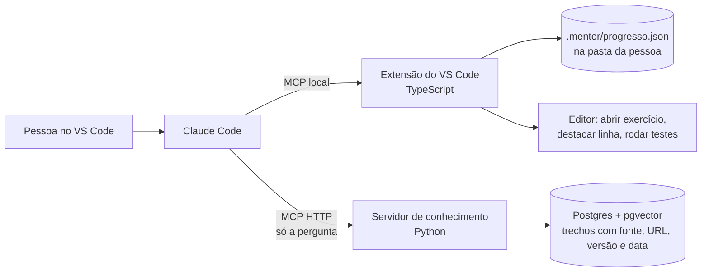

# Mentor

Um mentor de programação em português que vive dentro do VS Code. Ele ensina a pessoa a programar, em vez de programar por ela: dá dicas em camadas e só mostra a resposta se a pessoa pedir, lembra o que ela já domina e os erros que se repetem, e explica cada conceito a partir de um trecho citado da documentação oficial (MDN, TypeScript, Node.js e VS Code), com link e licença. A conversa acontece no Claude Code, que a pessoa já usa; o Mentor entra como dois servidores MCP.

## Arquitetura

São duas peças, separadas pelo lugar onde cada dado mora.

- **Servidor de conhecimento (`server/`, Python).** Servidor MCP com transporte HTTP. Coleta o Markdown dos repositórios oficiais, divide em trechos por título e faz busca híbrida: vetor multilíngue (bge-m3), para perguntas em português sobre docs em inglês, mais full-text, para nomes como `Map.prototype.get`, combinados por Reciprocal Rank Fusion. Expõe a ferramenta `buscar_docs` e os prompts com o jeito de ensinar (`dica`, `aula`, `exercicio`, `revisar`, `prova`, `entrevista`). Não recebe código nem dados pessoais.
- **Extensão do VS Code (`extension/`, TypeScript).** Registra um servidor MCP local, que só escuta em `127.0.0.1` e exige token. Guarda o progresso num arquivo dentro da pasta de estudos, mostra a trilha em linha (o "caminho") e o painel de progresso, e executa ações no editor.

## Como rodar

- Servidor: [server/README.md](server/README.md) (Docker com Postgres, `uv`, Ollama com bge-m3).
- Extensão: [extension/README.md](extension/README.md) (instalação pelo `.vsix` e o comando "Mentor: conectar ao Claude Code"). A extensão está no PR #2 e ainda não entrou neste branch.

## Qualidade medida

| O que | Resultado | Como foi medido |
|---|---|---|
| Busca: recall@5 | **0,95** | 20 perguntas em `server/evals/retrieval.jsonl`, metade em português sobre docs em inglês, medidas por trecho, na ordem em que a ferramenta devolve (13/11/2026) |
| Busca: MRR | **0,75** | mesmo conjunto |
| Índice | 14.568 trechos da MDN, 320 do TypeScript, 6.974 do Node | bge-m3 local via Ollama. As docs do VS Code entram no PR #3 e ainda não foram incluídas nesta medida |
| Testes automatizados | servidor: 108; extensão: 50 | `uv run pytest` e `npm test` |
| Evals de conversa (não entregar a resposta antes da hora, citação correta, uso da memória) | **ainda não medido** | o código está no PR #3, mas a execução depende de chave de API de modelo (OpenRouter) |
| Custo e latência por chamada | **ainda não medido** | depende do servidor hospedado e do tracing com Langfuse ligado |

O conjunto de 20 perguntas é pequeno e foi escrito por mim; serve para comparar versões da busca, não para afirmar qualidade em geral.

## Privacidade

- O progresso fica em `.mentor/progresso.json`, dentro da pasta da pessoa. Nada disso sai da máquina.
- O servidor local da extensão escuta só em `127.0.0.1` e exige um token, guardado no `.mcp.json` da pasta. Esse arquivo não deve ser publicado.
- O servidor de conhecimento recebe só o texto da pergunta e um identificador anônimo da instalação (`X-Mentor-Install`), usado para o limite de 200 buscas por dia. Não recebe código, progresso nem conta.
- O tracing com Langfuse (PR #3) é opcional e não grava o texto da pergunta.

## Fontes e licenças

O código do Mentor é MIT. Os trechos de documentação servidos pela busca continuam sob a licença da fonte:

| Fonte | Licença | Como é atribuída |
|---|---|---|
| MDN (mdn/content) | CC-BY-SA 2.5 | "by Mozilla Contributors", link da página e link da licença em toda resposta com trecho da MDN |
| TypeScript Handbook (microsoft/TypeScript-Website) | CC BY 4.0 (conteúdo), MIT (código) | link da página e da licença |
| Node.js API (nodejs/node) | MIT | link da página |
| VS Code docs e notas de versão (microsoft/vscode-docs) | CC BY 3.0 US (código: MIT) | crédito, link da licença; sem uso de marca (PR #3) |

O roadmap.sh não é copiado: a trilha só tem link para ele. O pedido de permissão para usar a estrutura de tópicos ainda não foi feito.

## Status

**Pronto e testado localmente**

- Servidor de conhecimento com MDN, TypeScript e Node, busca híbrida com citação e limite por instalação (PR #1).
- Extensão com MCP local, trilha de fundamentos em TypeScript (8 unidades), caminho linear, painel de progresso e importação de diário em Markdown (PR #2).
- Docs do VS Code como fonte, recomendação de extensões por catálogo curado, prompts de processo profissional, CI, reindexação semanal, evals de conversa e tracing (PR #3).

**Depende de contas que ainda não existem**

- Servidor hospedado (banco no Neon e host do servidor). Hoje roda só localmente.
- Evals de conversa e reindexação agendada no CI (chave do OpenRouter e segredos do repositório).
- Tracing com Langfuse.
- Publicação da extensão no VS Code Marketplace.

## Falhas conhecidas

- A pergunta **"satisfies operator"** não é encontrada: ela espera uma página das notas de versão do TypeScript, e só o Handbook está indexado.
- A medida de busca é de 20 perguntas escritas por mim, sem revisão externa. O MRR de 0,75 mostra que a página certa nem sempre vem em primeiro lugar.
- As docs do VS Code ainda não entraram na medida de recall e MRR.
- Ninguém além de mim usou o Mentor ainda. A extensão só foi testada no meu ambiente.
- Rodar um exercício executa código JavaScript na máquina da pessoa. As ferramentas que fazem isso não devem ficar em "sempre permitir" no Claude Code.
- Só funciona com o Claude Code. Copilot e outros agentes ficam para depois.

## Licença

[MIT](LICENSE). Feito por Lorenzo Dotto ([GitHub](https://github.com/DottoLeao), [lorenzodotto.com.br](https://lorenzodotto.com.br)).
